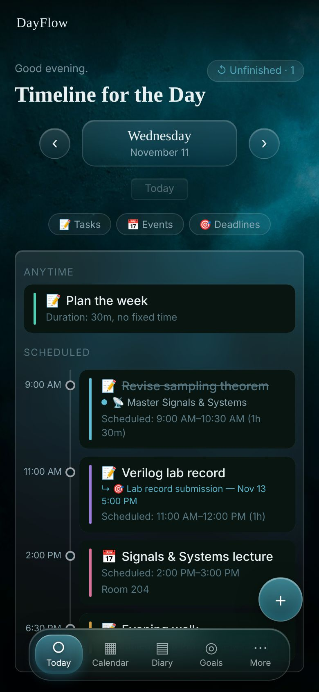
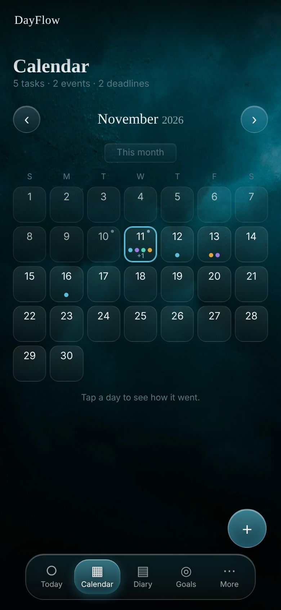
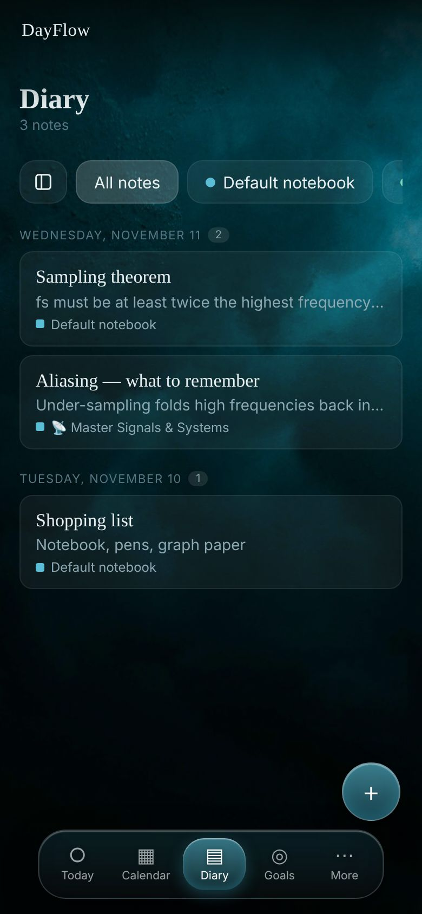
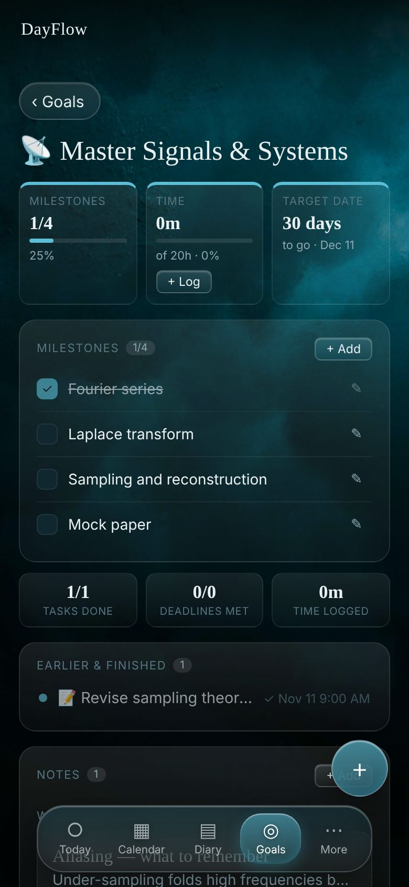
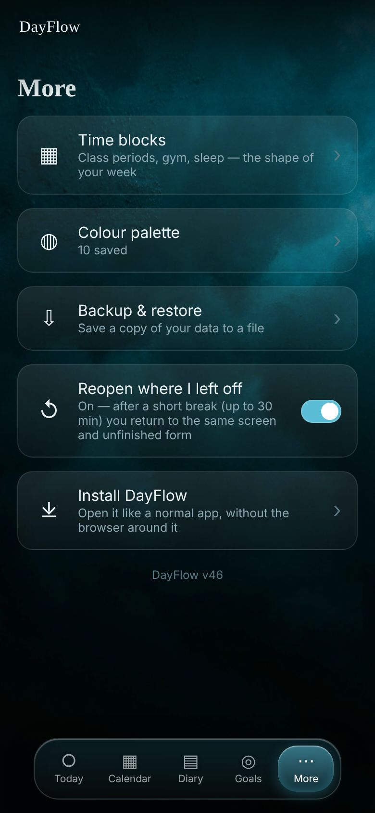

# DayFlow

**A calm, personal day planner that lives on your phone.**
Plan your day, keep your notes, and follow your goals in one place — with no account, no ads and no automatic scheduling. DayFlow only organises what *you* enter. It never decides your priorities for you and never nags.

<p align="center">
  
  
  
  
  
</p>
<p align="center"><sub>Today · Calendar · Diary · A goal · More (sample data)</sub></p>

## What it does

- **Today** — a timeline for the day with tasks, events and deadlines, plus time blocks for the shape of your week.
- **Calendar** — a month view; tap a day to see how it went.
- **Diary** — notebooks and a distraction-free note editor, plus a Goals notebook with notes for each goal.
- **Goals** — targets built from milestones, time spent and a date, with progress at a glance.
- **Yours alone** — everything is stored on your device. Nothing is uploaded unless you choose to back up to your own Google Drive.
- **Works offline** and can be installed like a normal app.

## User manual

### Today
- Tap **+** to add a **task**, an **event** or a **deadline**.
  - *Tasks* are things to do. They can have a start and end time, or just a duration ("anytime"), a colour, a goal, a personal deadline, and a link to an event or deadline.
  - *Events* happen at a time and place (a lecture, a meeting).
  - *Deadlines* are things due on a date, with an optional time.
- Use the arrows to move between days, or tap **Today** to return.
- **Swipe a task right** to mark it done; **swipe left** to start or pause its timer.
- **Swipe a deadline right** to mark it met; **swipe left** to skip it.
- **Tap** any item for its menu: Edit, Reschedule, Skip, Delete. **Press and hold** for a quick overview.
- **Unfinished** — a button in the top-right corner appears when a task has slipped past: a timed task two hours after it ended, or an anytime task once its day is over. Open it to **Reschedule** or **Skip** each one. Rescheduling keeps the task's link to an event or deadline only if that date still comes after the task's new time.
- **Time blocks** (under *More*) are repeating parts of your week, such as classes or sleep. Tasks and events can be placed inside them.

### Calendar
Swipe or use the arrows to change month. Dots under a date show what is planned. Tap a date to see its tasks, events and deadlines, and open it in Today.

### Diary
- Notes are grouped by day and organised into **notebooks**. Pick a notebook from the row at the top, or add your own.
- The built-in **Goals** notebook lists your goals; open one to read and write its notes. A goal's own page shows the same notes.
- In a note, type a title, then write. Type **/** at the start of a line for a menu of styles (headings, lists, divider and more), or use the **Aa** button for text sizes and formatting. A note saves as you type.

### Goals
- A goal can have any mix of three targets: **milestones** (a checklist), **time** (hours spent) and a **target date**.
- Time counts when you run the timer on tasks linked to the goal.
- Dates that have passed read "N days past". You can pause, resume (choosing a new target date) or mark a goal achieved.
- Each goal page shows progress, milestones, linked tasks, deadlines and its notes.

### More
- **Time blocks** and **Colour palette** — your weekly shape and your saved colours.
- **Backup & restore** — save a copy of everything to a `.json` file and restore it later (it previews what will change and can be undone). Optionally back up to your own Google Drive; this is always manual and only touches one file DayFlow creates. **Wipe data** clears everything, or everything except your settings.
- **Reopen where I left off** — when on, coming back within 30 minutes returns you to the same screen, open note or unfinished form. Turn it off to always start on Today.
- **Install DayFlow** — adds it to your home screen as a standalone app.

### Good to know
- Your data lives in the browser on the device you use. Back up now and then, especially before switching phones.
- To move between devices, back up on one and restore on the other.
- Updating the app never changes your stored data.

## Built with

Plain HTML, CSS and JavaScript (ES modules) — no framework, no build step, no dependencies. Data is kept in `localStorage`, and a service worker provides offline use. Because every path is relative, it works from a GitHub Pages project address or a custom domain.

```
index.html        app shell
manifest.json     install details (name, icons, colours)
sw.js             offline cache
css/style.css     all styles
js/               app code (screens/, components/, store, utils…)
icons/ img/       app icons and background
docs/             screenshots used in this README
CHANGELOG.md      what changed in each version
```

## Version history

See [CHANGELOG.md](CHANGELOG.md).
